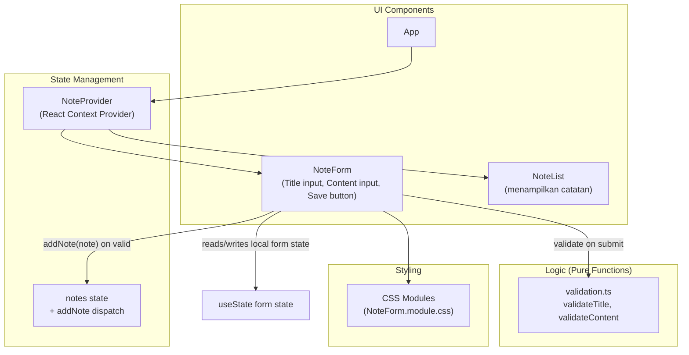

# Design Document: Add New Note

## Overview

Fitur "Tambah Catatan Baru" menyediakan formulir bagi pengguna untuk menambahkan catatan baru ke daftar catatan. Formulir terdiri dari kolom input Title, kolom input Content, dan tombol Save. Sistem memvalidasi input sebelum menyimpan: Title wajib diisi dengan panjang 1 hingga 50 karakter, dan Content minimal 3 dan maksimal 50 karakter. Jika validasi gagal, pesan error berwarna merah ditampilkan di bawah kolom yang gagal dan catatan tidak disimpan. Jika validasi lulus, catatan baru ditambahkan ke `Note_Context` dan kolom input dikosongkan beserta pesan error-nya.

Stack yang digunakan: React dengan TypeScript, React Context API untuk manajemen state, dan CSS Modules untuk styling. Validasi diekstrak sebagai **fungsi murni (pure functions)** yang terpisah dari komponen UI agar mudah diuji secara terisolasi menggunakan property-based testing, sementara interaksi UI diuji dengan contoh (example-based) dan integration test.

### Keputusan Desain Utama

1. **Validasi sebagai fungsi murni terpisah** — `validateTitle` dan `validateContent` tidak bergantung pada React, sehingga dapat diuji dengan property-based testing tanpa merender komponen.
2. **Trim sebelum validasi** — Title dan Content divalidasi berdasarkan panjang setelah di-trim (menghapus whitespace di awal/akhir). String yang hanya berisi whitespace dianggap kosong agar tidak menghasilkan catatan yang tidak bermakna. Nilai yang disimpan ke `Note_Context` adalah nilai yang sudah di-trim untuk konsistensi. Keputusan ini memperkuat Requirement 2 (judul "yang bermakna") dan Requirement 3 (konten "yang cukup") tanpa mengubah ambang batas karakter.
3. **Ambang batas mengikuti requirement** — Title valid jika 1 ≤ `trimmed.length` ≤ 50; Content valid jika `trimmed.length` ≥ 10.
4. **ID unik** — Setiap Note mendapat `id` unik menggunakan `crypto.randomUUID()` (tersedia di browser modern), dengan fallback ke kombinasi `Date.now()` + angka acak bila tidak tersedia.

## Architecture

Aplikasi mengikuti pola React standar dengan pemisahan tanggung jawab yang jelas antara manajemen state (Context), presentasi (komponen), logika validasi (modul murni), dan styling (CSS Modules).



### Alur Data

1. Pengguna mengetik di kolom Title/Content → `NoteForm` menyimpan ke *local form state* (`useState`) dan menampilkan nilai (controlled components).
2. Pengguna klik Save → `NoteForm` memanggil `validateTitle` dan `validateContent`.
3. Jika salah satu validasi gagal → tampilkan Error_Message di bawah field yang gagal, jangan panggil `addNote`.
4. Jika semua validasi lulus → panggil `addNote` dari `NoteContext`, lalu kosongkan kedua input dan hapus semua Error_Message.
5. `NoteProvider` menyimpan Note baru ke state `notes`; `NoteList` merender ulang daftar catatan.

## Components and Interfaces

### NoteProvider

React Context Provider yang menyimpan daftar catatan dan menyediakan fungsi `addNote`.

```typescript
interface NoteContextValue {
  notes: Note[];
  addNote: (note: Note) => void;
}

const NoteContext = createContext<NoteContextValue | undefined>(undefined);

function NoteProvider({ children }: { children: React.ReactNode }): JSX.Element;

// Hook akses context
function useNotes(): NoteContextValue;
// throws Error bila dipakai di luar NoteProvider
```

`useNotes` melempar error bila dipanggil di luar `NoteProvider` agar kesalahan wiring terdeteksi saat development.

### NoteForm

Komponen formulir dengan controlled inputs. Mengelola state form lokal (nilai Title, nilai Content, dan error per field) dan memicu validasi saat tombol Save diklik.

```typescript
interface NoteFormProps {
  // tidak ada props; mengakses addNote via useNotes()
}

function NoteForm(): JSX.Element;
```

Perilaku internal:
- State: `titleValue: string`, `contentValue: string`, `titleError: string | null`, `contentError: string | null`.
- Saat field berubah, memperbarui nilai. Error field dihapus ketika nilai field menjadi valid (sesuai Requirement 2.3 dan 3.2) agar pengguna mendapat umpan balik langsung saat memperbaiki input.
- Saat Save diklik: jalankan `validateTitle(titleValue)` dan `validateContent(contentValue)`. Set error untuk field yang gagal. Bila keduanya valid, panggil `addNote`, lalu reset semua state form.

### Validation Module (`validation.ts`)

Modul fungsi murni tanpa dependensi React.

```typescript
export const TITLE_MAX_LENGTH = 50;
export const CONTENT_MIN_LENGTH = 3;
export const CONTENT_MAX_LENGTH = 50;

export interface ValidationResult {
  valid: boolean;
  error?: string; // pesan error untuk ditampilkan; undefined bila valid
}

export function validateTitle(title: string): ValidationResult;
export function validateContent(content: string): ValidationResult;
```

Aturan:
- `validateTitle`: `valid = true` jika `1 ≤ title.trim().length ≤ 50`. Jika tidak valid, `error` menjelaskan penyebabnya (kosong atau melebihi 50 karakter).
- `validateContent`: `valid = true` jika `3 ≤ content.trim().length ≤ 50`. Jika tidak valid, `error` menjelaskan penyebabnya (kurang dari 3 karakter atau melebihi 50 karakter).

### ID Utility (`id.ts`)

```typescript
export function createId(): string;
// memakai crypto.randomUUID() bila tersedia, bila tidak fallback Date.now()+random
```

## Data Models

### Note

Struktur catatan yang disimpan di `Note_Context`.

```typescript
interface Note {
  id: string;        // unik, dari createId()
  title: string;     // nilai title yang sudah di-trim, 1..50 karakter
  content: string;   // nilai content yang sudah di-trim, 3..50 karakter
  createdAt: string; // ISO 8601 timestamp, dari new Date().toISOString()
}
```

### Form State (internal NoteForm)

```typescript
interface NoteFormState {
  titleValue: string;
  contentValue: string;
  titleError: string | null;
  contentError: string | null;
}
```

### Validation Constants & Result

```typescript
const TITLE_MAX_LENGTH = 50;
const CONTENT_MIN_LENGTH = 3;
const CONTENT_MAX_LENGTH = 50;

interface ValidationResult {
  valid: boolean;
  error?: string;
}
```

### Konstanta Pesan Error

```typescript
const ERROR_TITLE_EMPTY = "Judul tidak boleh kosong.";
const ERROR_TITLE_TOO_LONG = "Judul tidak boleh lebih dari 50 karakter.";
const ERROR_CONTENT_TOO_SHORT = "Isi catatan minimal 3 karakter.";
const ERROR_CONTENT_TOO_LONG = "Isi catatan tidak boleh lebih dari 50 karakter.";
```

## Correctness Properties

*A property is a characteristic or behavior that should hold true across all valid executions of a system — essentially, a formal statement about what the system should do. Properties serve as the bridge between human-readable specifications and machine-verifiable correctness guarantees.*

Setelah menelaah setiap acceptance criteria dan melakukan property reflection, dihasilkan lima properti yang tidak redundan. Properti 1 dan 2 menguji logika validasi murni (`validateTitle`, `validateContent`) — cocok untuk property-based testing karena fungsi murni dengan input yang bervariasi. Properti 3–5 menguji perilaku simpan pada level komponen/context menggunakan generator input yang sesuai.

### Property 1: Title validation correctness

*For any* string `title`, `validateTitle(title).valid` is `true` if and only if `1 ≤ title.trim().length ≤ 50`; otherwise `valid` is `false` and `error` is defined. Untuk semua title yang hanya berisi whitespace (trimmed length 0) atau trimmed length melebihi 50, validasi wajib gagal.

**Validates: Requirements 2.1, 2.2, 2.3**

### Property 2: Content validation correctness

*For any* string `content`, `validateContent(content).valid` is `true` if and only if `3 ≤ content.trim().length ≤ 50`; otherwise `valid` is `false` and `error` menjelaskan penyebabnya (kurang dari 3 karakter atau melebihi 50 karakter).

**Validates: Requirements 3.1, 3.2, 3.3**

### Property 3: Valid save adds note with correct data

*For any* valid `title` (trimmed length 1–50) and valid `content` (trimmed length ≥ 10), mengirim form (klik Save) menambahkan tepat satu Note baru ke `Note_Context` yang `title`-nya sama dengan `title.trim()` dan `content`-nya sama dengan `content.trim()`.

**Validates: Requirements 4.1**

### Property 4: Successful save clears inputs and removes errors

*For any* valid `title` dan `content`, setelah simpan berhasil, nilai input Title dan Content menjadi kosong dan tidak ada Error_Message yang ditampilkan untuk kedua field.

**Validates: Requirements 4.2**

### Property 5: Invalid save shows error per failed field and does not add note

*For any* pasangan `title` dan `content` di mana setidaknya satu field tidak valid, mengirim form menampilkan Error_Message di bawah setiap field yang gagal validasi (dan tidak menampilkan error di field yang valid), serta panjang daftar catatan di `Note_Context` tidak berubah (tidak ada Note yang ditambahkan).

**Validates: Requirements 5.1, 5.2**

## Error Handling

| Skenario | Penanganan |
|----------|-----------|
| Title kosong / whitespace-only saat Save | Tampilkan `ERROR_TITLE_EMPTY` di bawah input Title; jangan simpan. |
| Title > 50 karakter saat Save | Tampilkan `ERROR_TITLE_TOO_LONG` di bawah input Title; jangan simpan. |
| Content < 3 karakter saat Save | Tampilkan `ERROR_CONTENT_TOO_SHORT` di bawah input Content; jangan simpan. |
| Content > 50 karakter saat Save | Tampilkan `ERROR_CONTENT_TOO_LONG` di bawah input Content; jangan simpan. |
| Field diperbaiki menjadi valid setelah error | Hapus Error_Message field tersebut segera (umpan balik langsung), sesuai Requirement 2.3 dan 3.3. |
| `useNotes` dipanggil di luar `NoteProvider` | Lempar `Error` dengan pesan "useNotes must be used within a NoteProvider" agar kesalahan wiring terdeteksi saat development. |
| `crypto.randomUUID` tidak tersedia | Fallback ke `Date.now() + Math.random()` agar `id` tetap unik. |
| Validasi kedua field gagal bersamaan | Tampilkan Error_Message di kedua field; jangan simpan. |

Tidak ada penanganan error jaringan/eksternal karena seluruh state dikelola di memori melalui React Context (tidak ada persistence layer dalam lingkup fitur ini).

## Testing Strategy

### Pendekatan Dwiguna (Dual Testing Approach)

- **Unit tests (example-based)**: memverifikasi contoh spesifik, edge case, dan error condition.
- **Property tests (property-based)**: memverifikasi properti universal di Property 1–5 menggunakan `fast-check` dengan minimal 100 iterasi per properti.

### Stack Testing

- **Runner**: Vitest (`vitest --run` untuk eksekusi tunggal, bukan watch mode).
- **Komponen**: `@testing-library/react` dan `@testing-library/user-event` untuk interaksi UI.
- **Property-based**: `fast-check` untuk properti validasi murni dan perilaku simpan.
- **Styling**: Error_Message berwarna merah diverifikasi via snapshot/visual assertion pada class CSS Module (bukan property).

### Implementasi Property Tests

Setiap property test harus:
- Menjalankan minimal 100 iterasi (konfigurasi `fast-check` `numRuns: 100`).
- Mereferensikan properti design document dengan tag komentar: `// Feature: add-new-note, Property {N}: {property_text}`.
- Diimplementasikan sebagai satu property-based test per properti.

Pemetaan implementasi:

- **Property 1 & 2** — diuji langsung terhadap fungsi murni `validateTitle`/`validateContent` dengan generator string `fast-check` (`fc.string()`, `fc.stringMatching`, atau custom arbiter untuk whitespace-only dan panjang tertentu). Biaya rendah (fungsi murni di memori) sehingga cocok untuk PBT murni.
- **Property 3, 4, 5** — diuji pada level komponen dengan `@testing-library/react` dalam `NoteProvider` test wrapper, menggunakan generator `fast-check` untuk pasangan `(title, content)` valid/invalid. Input diisi via `userEvent.type`, tombol Save diklik, lalu assertions pada daftar catatan dan state form.
- **Edge case yang harus tercakup oleh generator**: string kosong, whitespace-only, string dengan panjang tepat di batas (2, 3, 50, 51), karakter non-ASCII/unicode, dan leading/trailing whitespace.

### Unit Tests (Example-Based)

- Render formulir memuat ketiga elemen (Title input, Content input, Save button) — Requirement 1.1.
- Controlled input: mengetik di Title/Content memperbarui nilai yang ditampilkan — Requirement 1.2, 1.3.
- Pesan error merah muncul di bawah field yang gagal saat Save diklik dengan input kosong/invalid — Requirement 2.1, 2.2, 3.1, 3.2.
- Error hilang saat field diperbaiki — Requirement 2.3, 3.3.
- Setelah simpan berhasil, input dikosongkan dan tidak ada error — Requirement 4.2.
- `useNotes` melempar error bila dipakai di luar provider — error handling.

### Yang Tidak Diuji dengan PBT (dan alasannya)

- **Rendering UI (Requirement 1.1)**: verifikasi keberadaan elemen, tidak bervariasi dengan input → contoh tunggal.
- **Warna merah Error_Message**: properti styling, bukan logika → diverifikasi via assertion class CSS/snapshot.
- **Timestamp `createdAt`**: nilai waktu saat ini, tidak deterministik → diuji bahwa field ada dan format ISO 8601 valid, bukan nilai pasti.
